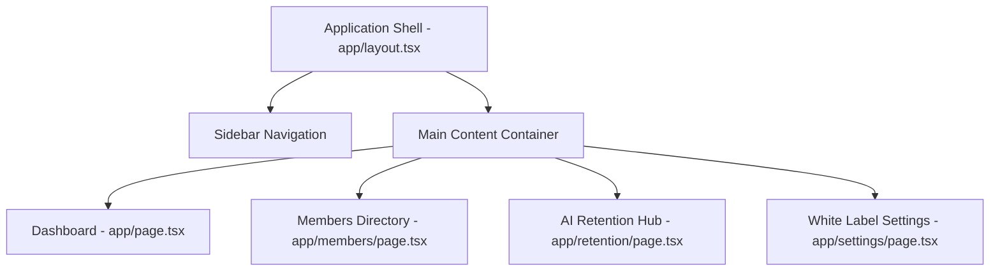

# White-Label Gym Management SaaS - Execution Plan

## System Architecture

## Styling & Theme Rules
- **Global Font:** `"Comic Sans MS", "Comic Sans", cursive` configured in [`tailwind.config.ts`](tailwind.config.ts:1) and [`app/globals.css`](app/globals.css:1).
- **Geometry:** `rounded-2xl` / `20px` minimum on all cards, buttons, inputs, and modals.
- **Palette:** High-contrast white/off-white background (`bg-slate-50`), soft pastel primary colors (soft blue/green), diffused drop-shadows (`shadow-xl shadow-slate-200/50`).

## Roadmap & Steps

### Step 1: Foundation
1. Run terminal command to initialize Next.js project with Tailwind CSS and TypeScript:
   `npx create-next-app@latest . --typescript --tailwind --eslint --app --src-dir=false --import-alias="@/*" --use-npm --no-git`
2. Configure [`tailwind.config.ts`](tailwind.config.ts:1) to enforce the global font family and soft edge utilities.
3. Configure [`app/globals.css`](app/globals.css:1) with high-contrast pastel variables and custom utilities.

### Step 2: Application Shell Layout
1. Implement [`app/layout.tsx`](app/layout.tsx:1) with responsive sidebar navigation linking to Dashboard, Members, Retention Hub, and Settings.
2. Add white-label brand header component displaying custom gym logo and name.

### Step 3: Dashboard Overview
1. Implement [`app/page.tsx`](app/page.tsx:1) with mock data metrics cards:
   - Total Active Members
   - Monthly Revenue
   - Expiring Subscriptions
2. Include quick actions and recent member activity stream.

### Step 4: Members Directory & CRUD
1. Implement [`app/members/page.tsx`](app/members/page.tsx:1) with data table displaying member details.
2. Build modular CRUD modals for adding, editing, and deleting member records.

### Step 5: AI Retention Hub
1. Implement [`app/retention/page.tsx`](app/retention/page.tsx:1) highlighting members expiring within 3 days.
2. Provide interactive "Send Automated WhatsApp Reminder" action buttons with toast feedback.

### Step 6: White-Label Settings
1. Implement [`app/settings/page.tsx`](app/settings/page.tsx:1) featuring custom logo upload and primary theme color picker.
